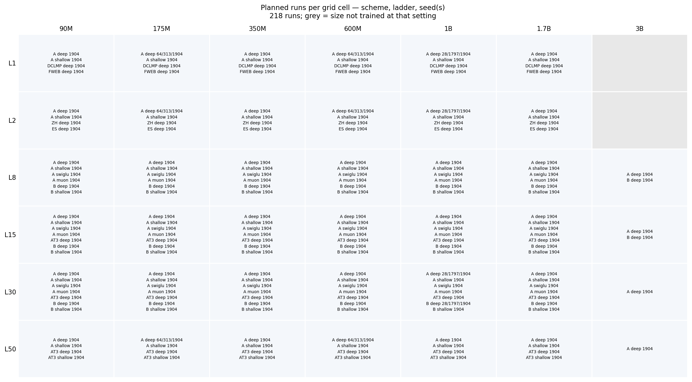
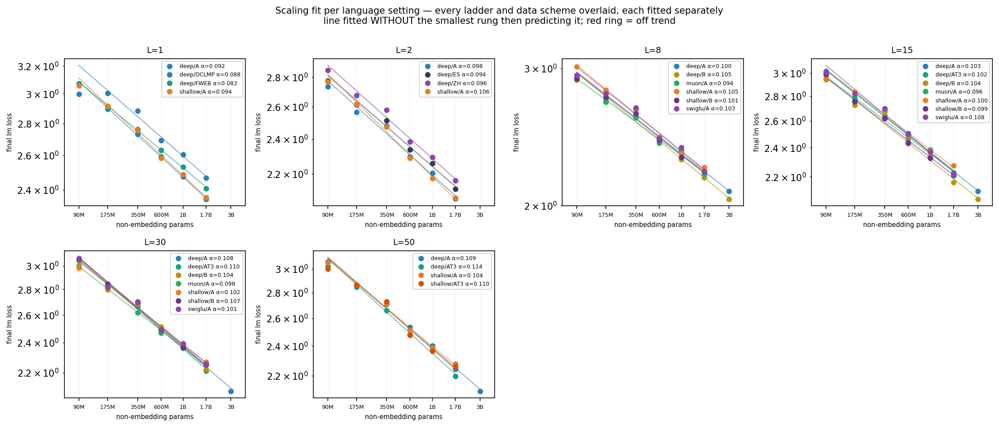
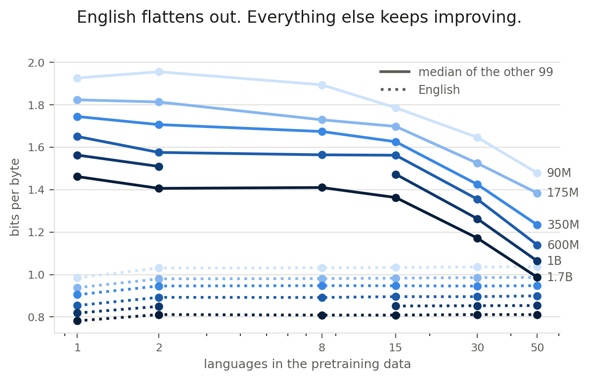
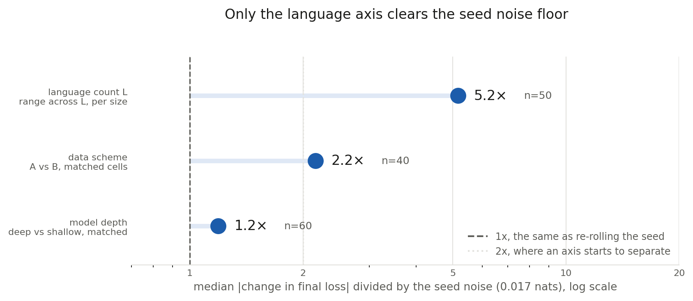

# Signal-Aware Multilingual Evaluation on a Small-to-Large Predictivity Ladder

**María Grandury** · École Polytechnique Fédérale de Lausanne (EPFL) · Research report, first written 14 September 2026, numbers updated 10 October 2026 (ladder report 2026-10-10 04:31)

## Abstract

Training multilingual language models requires repeated design decisions (data mixtures, architectures, tokenizers) that are made on small proxy models and evaluated on benchmark suites whose reliability degrades outside English. We extend the Signal-and-Noise framework of Heineman et al. (2025) to a controlled multilingual ladder: six model sizes from 90M to 1.7B non-embedding parameters with a 3B check, six language settings (1 to 50 languages at a fixed 50 % English share), five intervention axes (depth, language-list scheme, sampling temperature, activation and optimizer) and seed replicates. Each rung is trained to five times its Chinchilla budget and scored at twelve aligned checkpoints on per-language bits-per-byte (BPB) for 100 languages and on 47 benchmarks (892 language tasks) in the languages each cell trains. The ladder holds 218 runs, 212 of them from 90M to 1.7B. Four results stand out. Adding languages costs English once, at the first extra language, while the non-English median keeps falling. A third of the benchmark tasks never clear chance at any size, and the answer format decides most of that: scoring the answer text instead of a letter lifts Belebele from 5 to 86 of its 105 languages at 1.7B. The framework's checkpoint noise understates the seed-to-seed noise by a median factor of 1.75, which makes every checkpoint-noise SNR optimistic. And on the question the ladder was built for, a fully trained proxy from 90M to 1B ranks the design variants on benchmark accuracy at 0.51–0.57 decision accuracy against the 1.7B reference, while per-language BPB reaches 0.91–0.95 at every proxy except 600M (0.73). The 3B check gives the same picture. The analysis reads one published artefact, the per-checkpoint ladder report, so every number regenerates from the same file.

## 1. Introduction

Pretraining a multilingual model is a sequence of decisions taken on proxies: a smaller model, an earlier checkpoint, a cheaper benchmark. Each proxy is only useful if it ranks the alternatives the way the model that ships would. Heineman et al. (2025) showed, on the English DataDecide ladder, that a benchmark's *signal-to-noise ratio* (the dispersion of scores across model variants against the variability of a single run's late checkpoints) predicts both *decision accuracy* (the agreement between the small-model and the large-model ranking) and *scaling-law error*. Our earlier work (Grandury, 2026) carried the framework to a 36-model multilingual sweep over three data mixtures and 12 languages and found that the dispersion family of SNR definitions transfers across seeds, that the above-random gate removes most translated knowledge benchmarks at sub-1B scale, and that language and subject subsets can beat full benchmarks.

That sweep left the question the multilingual practitioner actually asks unanswered: **at a given number of languages, which model sizes can stand in for the large one when a design choice must be ranked, and how does the answer move as languages are added?** The predictivity ladder (Section 4) was built for that question. This report documents:

1. the pipeline that turns the ladder's published per-checkpoint table into the analyses of Section 5, with the logical fixes that surfaced while adapting it (Section 5.8),
2. the findings that are established on the trained rungs (Section 6),
3. the threats to validity the design carries (Section 7) and the plan to the paper (Sections 8–9).

**Research questions.** RQ1 Which multilingual benchmarks produce model rankings at small scale that hold at larger scale? RQ2 Can a benchmark metric computed at small scale (an SNR) predict that decision accuracy, removing the need to evaluate the large model? RQ3 Which benchmark design choices lead to higher reliability? RQ4 (added for the ladder) Which proxy sizes rank an intervention like the reference at each language count, and does per-language BPB agree with the benchmarks about it?

## 2. Related work

**Benchmark reliability.** Heineman et al. (2025) define signal as the relative dispersion of scores across models and noise as their variability across late checkpoints, and show that high-SNR benchmarks better preserve rankings and reduce scaling-law error. They validate checkpoint noise against seed re-runs on DataDecide (Magnusson et al., 2025), the 25-recipe × 4-size ladder we compare against in RQ3. Madaan et al. (2024) quantify evaluation variance from seeds and prompts. Polo et al. (2024) and item-response approaches show that small informative subsets can replace full benchmarks, the subset question of our RQ4. Schaeffer et al. (2024) explain why downstream capabilities are hard to predict from scale: emergent, multiple-choice metrics degrade the monotone signal that per-token losses carry, which is why the ladder's outcome metric is BPB and the benchmarks are the secondary signal.

**Scaling ladders.** The OLMo compute-efficient ladder (Bhagia et al., 2024) fixes non-embedding sizes and trains each rung at a multiple of the Chinchilla-optimal budget (Hoffmann et al., 2022), then predicts task scores through a two-step fit. The ladder here follows its size convention and its 5×C budget. Hägele et al. (2024) show that warmup-stable-decay schedules give properly annealed endpoints at several budgets from one run, which is how we propose to test whether 5×C is the right budget at high language counts (Section 8). Choshen et al. (2024) catalogue the ways scaling-law fits go wrong with few points. Our per-language fits use three to six rungs and are read as prediction error, not as laws.

**Multilingual scaling.** The "curse of multilinguality" (Conneau et al., 2020) and its later quantification (Chang et al., 2024) describe the per-language cost of adding languages at fixed capacity. ATLAS-style multilingual scaling laws put the compute-optimal tokens-per-parameter ratio well above 20 as the language count grows, which motivates both the fixed 50 % English share and the open budget question. Benchmark coverage across the ladder's 100 validation languages comes from Belebele (Bandarkar et al., 2024), Global-MMLU (Singh et al., 2025), INCLUDE (Romanou et al., 2025), Global PIQA (Chang et al., 2025), MultiBLiMP (Jumelet et al., 2026), IrokoBench (Adelani et al., 2025) and the classic XNLI / XStoryCloze / XCOPA / XWinograd / PAWS-X families. Their provenance (human vs machine translation, native authoring, template generation) is the design axis of RQ3.

## 3. The framework

For a benchmark *b* and a model size *s*, let *mj* be the final score of design variant *j* and *ct* the score of the reference run at late checkpoint *t*.

- **Signal** = maxj,k |mj − mk| / m̄, the relative dispersion across variants (the "mean pairwise distance" and 20 other variants in `snr/snr_variants.py` replace the max by other spread statistics).
- **Noise** = the residual standard deviation of *ct* around a line through the noise window (the k/20 checkpoints in the last 20 % of the run, 80–100 %), divided by the mean. Since 2026-10-08 this detrended noise replaces the raw standard deviation, which kept the cooldown trend. On the ladder we also measure the sample standard deviation over seed replicates where the ×3 cells exist.
- **SNR** = Signal / Noise.
- **Decision accuracy** = the fraction of variant pairs ordered the same way at the proxy and at the reference (`decision_acc_fast`). **DA-size** compares a proxy's final checkpoint with the 1.7B final, **DA-ckpt** an early checkpoint (each tenth of the run) with the final one within a size, and **DA-goal** an early proxy checkpoint with the 1.7B final. A decision cell needs at least three pairs.
- **Scaling-law error** = the relative error of the reference's per-language BPB predicted by a power law log BPB = a − α log N fitted on the proxy rungs.
- **Above-random gate**: a run clears chance on a task when the one-sided 95 % Wilson lower bound of its accuracy over the task's items exceeds 1/noptions. A (task, size) cell is above chance when at least half of the runs of that size that train the task's language clear it. The gate reads raw scores and option counts only. It replaced the fixed +0.05 margin of the 36-model sweep.

The ladder adds one construct: **intervention decision accuracy** over a population of items. With two levels of an intervention (deep vs shallow, scheme A vs B) the pairwise definition reduces to sign agreement of the level difference between proxy and reference, and the population is the set of per-language BPB values (or benchmark tasks) the two levels share.

## 4. Experimental design

Figure 1. The predictivity ladder: language settings (rows) × non-embedding sizes (columns). Each cell lists data build, architecture and seeds. The grid holds 218 runs, every one finished in the 2026-10-10 report.

| | 90M | 175M | 350M | 600M | 1B | 1.7B |
|---|---|---|---|---|---|---|
| Layers × dmodel (deep) | 15 × 768 | 16 × 1024 | 20 × 1280 | 24 × 1536 | 28 × 1792 | 30 × 2304 |
| Layers × dmodel (shallow) | 8 × 1024 | 10 × 1280 | 14 × 1536 | 14 × 2048 | 17 × 2304 | 20 × 2816 |
| Tokens (D = 100·N) | 9.3B | 17.6B | 34.4B | 59.5B | 94.4B | 167.2B |
| Global batch (sequences) | 84 | 168 | 504 | 504 | 504 | 504 |
| Checkpoints evaluated | 12 | 12 | 12 | 12 | 12 | 12 |
| Language settings K | all 6 | all 6 | all 6 | all 6 | all 6 | all 6 |
| Seeds | 1 | 3 at K ∈ {1, 2, 50} | 1 | 3 at K ∈ {1, 2, 50} | 3 at K ∈ {1, 2, 30} | 1 |

**Models.** Sizes are non-embedding parameters (Bhagia et al., 2024). The 131k Apertus vocabulary would otherwise dominate the small rungs. Deep and shallow ladders share layer structure (head dim 64, FFN ×4, GQA 4) and differ only in aspect ratio (width/depth ≈ 64 vs ≈ 128) at equal N (±5 %). The 600M shallow model is the exception in compute: it has 3.7 % more non-embedding parameters than the deep one and spends about 15 % more training compute. AdEMAMix, WSD schedule, peak learning rate scaled with each run's own budget, width-scaled init, sequences of 4,096 tokens. The 90M and 175M rungs were retrained at their own batch (84 and 168 sequences) in September, which removed the divergence the first 90M runs showed. Two extra levels run on the deep architecture at K ∈ {8, 15, 30}: SwiGLU instead of xIELU, and Muon instead of AdEMAMix. Six deep seed-1904 cells continue to 3B (scheme A at K ∈ {8, 15, 30, 50}, scheme B at K ∈ {8, 15}) as a check above the 1.7B reference.

**Data.** English from DCLM-edu, the other languages from FineWeb-2-HQ. Every multilingual setting is 50 % English, the rest allocated across the setting's languages. Scheme A takes the top-(K−1) FineWeb-2 subsets by bytes at temperature T = 1, and AT3 uses the same lists at T = 3 (K ∈ {15, 30, 50}). Scheme B replaces the lists with script- and family-diverse picks at K ∈ {8, 15, 30}. At K = 2 the second language is Russian (A), Chinese or Spanish, and at K = 1 the English corpus is DCLM-edu (A), DCLM without its educational filter, or FineWeb. The analysis reads every build as scheme A/B/C × temperature T. The K = 100 setting was planned and dropped. Lists are nested across settings.

**Outcome metrics.** Per-language BPB on a fixed validation set (English and 99 FineWeb-2 languages, about 5M tokens per language, carved out of each subset and excluded from training), and the `auto` benchmark group of the swiss-ai `lm-evaluation-harness` fork intersected with each cell's trained languages (110 tasks at K = 1, 892 at K = 50). We evaluate the ten tenths of every run plus 85 % and 95 %, twelve aligned checkpoints, and read the run along the ten tenths in Chinchilla multiples (1C at 20 %, 5C at the end). The ladder's compute axis is 6 × (Nnon-emb + d·V) × D.

**Source of truth.** `src/pretrain/ladder_report.py` builds one wide table (one row per checkpoint, one column per measurement) from the training logs, the harness results and the BPB files, and publishes it to the Hugging Face dataset `msnr-data/ladder-report`. The analysis package loads that file, melts it into a long (model, checkpoint, task) frame in which per-language BPB is a task like any benchmark, drops diverged and unfinished runs, and restricts checkpoints to the grid every size shares so that the noise window spans the same fraction of training at every rung.

## 5. Analyses

Each research question is one directory under `src/signal-and-noise/analysis/`, read results-first. `run_all_predictivity.sh` runs them in dependency order and rewrites the results blocks of every README. The status column gives one headline number per analysis on the 2026-10-10 report.

| RQ | question | method | folder | status |
|---|---|---|---|---|
| RQ0 | Which benchmark tasks clear chance at which size, and why not? | Wilson gate per (task, size), answer-format reformulations, share above chance against the tokens of the language | `rq00_*` | run. 377 of 933 trained tasks above chance at 90M, 599 at 1.7B, 313 never |
| RQ1 | Does a benchmark rank the design variants at a small size or an early checkpoint like the reference? | DA-size, DA-ckpt and DA-goal against the 1.7B reference, with a permutation null and decisive pairs | `rq02_*` | run. DA-size on accuracy 0.51–0.57 from 90M to 1B, per-language BPB 0.91–0.95 except 600M (0.73) |
| RQ2 | Which of 22 SNR definitions predicts DA, per language, and does it survive a seed swap? | per-language Pearson r of log SNR against DA, seed holdout, variant families, statistics beyond SNR | `rq03_noise_and_snr`, `rq04_surrogates` | run. Relative-spread family leads (`rel_std` r = 0.52 with DA-size, 0.56 with DA-ckpt), seed-holdout ρ 0.72 / 0.55 |
| RQ3 | Does our SNR agree with AllenAI DataDecide on the shared English tasks? | Pearson r / Spearman ρ over the shared gated tasks | `rq07_external_frameworks` | run. Nine shared tasks, ρ = 0.77 |
| RQ4 | Can a language or subject subset beat the full benchmark's SNR beyond what selection gives for free? | cumulative subset sweep against a random-subset null | `rq08_subset_selection` | run. Beats the null in 94 of 254 cells |
| RQ5 | Which design features predict SNR? | Kruskal–Wallis over curation, source, format, option count, passage | `rq09_benchmark_design` | run. Option count separates the families (H = 11.32, p = 0.003), nothing orders them by DA-size |
| RQ6 | Which proxy sizes rank an intervention like the reference at each K? | intervention DA over per-language BPB and benchmarks, scaling-law error, effect against seed and checkpoint noise, the 3B rung | `rq05_design_decisions`, `rq06_language_transfer`, `rq10_size_generalisation` | run. BPB reads temperature at 0.95–0.99 and the lists at 0.77–1.00, benchmarks at 0.45–0.63 |

### 5.1 RQ0: curves and the above-random gate

Score-vs-FLOPs curves per benchmark family, one line per language setting and size, and the gate: a run clears chance when the one-sided 95 % Wilson lower bound of its accuracy exceeds the chance level, and a (task, size) cell is above chance when half of the size's runs that train the language clear it. Chance comes from the option counts in `configs/tasks.json`. Per-language BPB, the bBPB twins and generative tasks have no chance level and are never gated. Every downstream cell that fails the gate is set to NaN, so the gate propagates to all RQs and never depends on any of them. Two companions test the cause: the reformulated twins (`rf_` drops the letters, `rfgm_` rewrites the items with Gemini) and the share above chance against the tokens of the language a checkpoint has seen.

### 5.2 RQ1: decision accuracy

The truth the rest is scored against. Models are the ladder's cells. The cross-size identity is the cell's design variant (language setting, data build, architecture, activation, optimizer), so a variant trained at two sizes is one pair. Pairs are formed among the seed-1904 runs of every build and ladder, and the replicate seeds serve only as a noise baseline. DA-size compares each proxy's final checkpoint with the 1.7B final, DA-ckpt each tenth of a run with its final, and DA-goal each tenth with the 1.7B final. Multilingual tasks are evaluated only on cells that train the language, so each task's population is the variants that exist at both sizes and were evaluated on it. A cell needs three pairs, and `n` is reported with every value. Single-axis (one design choice differs) and multi-axis pairs are reported apart.

### 5.3 RQ2: the SNR definition

Twenty-two variants of the SNR (dispersion, relative-spread, discrepancy, robust and depth families) computed per (task, size) from the variants' final scores and the detrended checkpoint noise, correlated per language with DA-size and DA-ckpt as Pearson r of log10 SNR. The seed holdout trains the variant ranking on the replicate seeds (64 and 313 at 175M and 600M, 28 and 1797 at 1B) and tests it on seed 1904 of the same cells. Only a ranking that survives the swap is reported as a recommendation, and at the family level, since the 36-sweep showed the exact argmax never transfers. `rq04_surrogates` adds the statistics beyond SNR: signal and noise alone, the margin above chance, early-checkpoint agreement and the scaling-fit R².

### 5.4 RQ3: agreement with DataDecide

Cross-corpus Pearson r and Spearman ρ of log SNR over the English tasks both corpora evaluate and the gate keeps. DataDecide's "signal" is a dispersion over 25 data recipes, and ours is over language settings, builds and architectures, a different axis. A low correlation says the populations differ before it says the definition does, and the SNR level never compares across corpora, only the task order.

### 5.5 RQ4: subsets

For each multilingual family the per-language tasks are ranked by standalone SNR and cumulative subsets swept. The best subset and its gain over the full set are recorded per size, against a random-subset null of the same size, since picking the best of many subsets gains SNR by selection alone. The per-language BPB family is swept the same way.

### 5.6 RQ5: benchmark design

Per-family SNR (median over its per-language tasks at 1.7B) grouped by curation method, source origin, task format, option count and a reading-passage flag, tested with a family-level Kruskal–Wallis, and the same characteristics set against DA-size.

### 5.7 RQ6: proxy predictivity

Three reads over the (proxy size, K) grid, now against the 1.7B reference at every K. (i) *Intervention DA*: for each K and intervention, DA is the fraction of population items (per-language BPB on the languages both levels train, the benchmark tasks, or the macro-BPB decision) on which the proxy agrees with the reference about which level is better. (ii) *Scaling-law error*: per language, log BPB = a − α log N fitted on the proxy rungs predicts the reference's BPB. (iii) *Effect vs noise*: every decision's |Δ| against the seed noise and the detrended checkpoint noise. A decision inside the noise is a coin flip whatever its DA. `rq10_size_generalisation` repeats the reads with the six 3B cells as the reference.

### 5.8 What changed in the code

The 36-sweep pipeline read a per-(model, checkpoint, task) parquet built from the cluster's eval logs. The ladder pipeline reads the ladder report. The adaptation kept every analysis script and changed the inputs: a loader for the wide table, pool definitions whose member filters apply to the ladder's axes, task metadata from `configs/tasks.json` (116 languages instead of a 12-entry map), the gate keyed on option counts with a fallback, and reference sizes that fall back to the largest rung with data while the big rungs train. We found five logical faults on the way. The analysis configuration had lost the checkpoint-DA fractions and the size buckets, so the package failed at import. The documented FLOPs convention was not implemented. The ladder report mislabelled trained languages (an iso3-prefix comparison against iso2 codes) and read the BPB files unguarded. The models registry lacked the scheme-B cells and the 1B row's adopted seeds. And the auto-eval watchers' due rule (`iter % (2 × interval)`) could never mark the 1B cells trained on the older 2,287-iteration grid as due, so those cells would never have been evaluated. Two more surfaced when the evaluation branch was merged in: the source registry's `loader` key was dropped in the merge, which routed every ladder pool to the 36-sweep parquet and reported the wrong models under the ladder's name instead of failing. It is now fixed at the root by deriving the loader from the split. And `cell_fineweb_subsets` was inlined away on the other side while the RQ6 script still imported it. Since then the analysis rules have been collected in `src/signal-and-noise/analysis/RULES.md` and are checked by `check_rules.py` after every refresh. Details are in the commit messages.

## 6. Findings

Every number in this section comes from one artefact: the wide per-checkpoint table `ladder_report.csv`, published to `msnr-data/ladder-report` and read from the repository branch `data/ladder-report`, report of 2026-10-10 04:31, run through `run_all_predictivity.sh` on 10 October 2026. The detailed populations and caveats are in each RQ folder's README.

**What the ladder contains today.** The report holds 219 cells, 218 of them complete, and none diverged. The grid is 218 runs, 212 of them from 90M to 1.7B. The headline pool `predictivity` holds the 192 seed-1904 runs with benchmark scores at 90M–1.7B (31–33 per size), every ladder and data build included. The six 3B cells serve only as a check above the reference. Seed replicates exist at 175M and 600M for K ∈ {1, 2, 50} and at 1B for K ∈ {1, 2, 30}: nine ×3 cells, which carry the seed-noise estimate.

Figure 2. Final training loss vs non-embedding parameters per language setting, architectures and schemes overlaid and fitted separately on the larger rungs, then asked to predict the smallest. Red rings mark rungs off the fit.

**The 90M rung is back on the ladder.** The first 90M runs reached their best loss at 15–19 % of training and degraded after it, because the optimizer's timescale was fixed in steps while the run lengths span 18× across the ladder. Retraining 90M and 175M at their own batch (84 and 168 sequences) removed the problem. No run diverges in the current report, and the largest scaling residual of any cell is 0.13 nats (90M, K = 1, DCLM without the edu filter).

**Scaling behaves, and the exponent grows slowly with K.** Final loss falls monotonically with size at every language setting. On the deep scheme-A ladder the fitted loss exponent is α = 0.085 at K = 1, 0.094 at K = 2, 0.097 at K = 8, 0.100 at K = 15, 0.103 at K = 30 and 0.104 at K = 50, and 0.077–0.108 over the 31 six-rung (K, ladder, build) fits. The chains stay on the line up to 3B: at K = 8 the deep loss goes 2.928 → 2.729 → 2.659 → 2.432 → 2.357 → 2.193 → 2.087 from 90M to 3B, and at K = 50 3.061 → 2.848 → 2.708 → 2.532 → 2.402 → 2.243 → 2.104, with residuals within ±0.07 nats. Adding languages moves the intercept and, slightly, the slope.

Figure 3. Held-out bits-per-byte at the final checkpoint, deep / scheme A / seed 1904. English pays a one-time cost at the first extra language and almost nothing after. The non-English median falls throughout.

**The multilingual tax is paid once.** English BPB at 600M goes 0.854 (K = 1) → 0.892 (K = 2) → 0.899 (K = 50): **+0.038 bits/byte for the first extra language, +0.007 for the next 48**. At 1.7B it is 0.782 → 0.811 → 0.811. The K = 1 cell has the lower English BPB in all 30 (size, K) comparisons at both depths. The non-English median falls throughout: 1.650 → 1.139 at 600M and 1.823 → 1.383 at 175M from K = 1 to K = 50, and 1.484 → 1.063 between K = 8 and K = 50 at 1B. Comparing K = 50 against K = 2 language by language, K = 50 wins on 81, 81, 78, 78 and 87 of the 99 non-English languages at 175M, 350M, 600M, 1B and 1.7B, with median gains of 0.30 to 0.36 bits/byte. The seed standard deviation of macro BPB is 0.002–0.022 on the nine ×3 cells.

**A third of the benchmark suite never clears chance, and the answer format decides most of it.** On the 933 tasks with a chance level in trained languages, 377 (40 %) are above chance at 90M and 599 (64 %) at 1.7B, and 313 (34 %) are at chance at every size. Over everything we considered (1,454 tasks with a chance level, screened benchmarks included), the gate keeps 61 % at 1.7B. The option count is not the cause: two- and four-option trained tasks pass at similar rates at 1.7B (83 of 122 against 488 of 759). The answer format is. Scoring the answer text instead of the letter lifts Belebele from 5 to 86 of its 105 languages at 1.7B, Global-MMLU from 1 to 35 of 37 and INCLUDE from 3 to 31 of 43 (McNemar 82 : 1, 34 : 0 and 29 : 1). The Gemini rewrite of Belebele passes in every trained language at every size. Tokens of the language matter as well, but do not suffice: outside English the share of cells above chance stays near 40 % up to 108 tokens of the language and rises to 63 % at 1010–1011, and at 108–109 tokens 43 % of the 90M cells clear chance against 63 % of the 1.7B cells. The letter-format INCLUDE stays at chance at every token count.

**MultiBLiMP, HellaSwag and XStoryCloze separate the design variants best.** At 1.7B the sharpest families by median SNR are MultiBLiMP (2.39, 34 tasks), HellaSwag (2.29, 26) and XStoryCloze (2.18, 8). The reformulated twins and the English-only benchmarks fill the lower half (0.56 to 1.09). Per language, the highest-SNR above-chance benchmark is most often the bBPB twin of the Gemini-rewritten INCLUDE (12 of 50 languages), and the language's own BPB outranks that benchmark in 23 of the 50 languages that have both. Two cautions travel with this. MultiBLiMP is a minimal-pair grammaticality test, so a high SNR there says the models are separable on morphosyntax, not on knowledge or reasoning. And a high SNR is not a high decision accuracy, as the next paragraphs show.

**SNR predicts decision accuracy moderately, and only as a family.** The relative-spread definitions (`rel_std`, `rel_mpd`, `rel_dispersion`) lead as a block, with a mean per-language Pearson r of log10(SNR) against DA of 0.51–0.52 under DA-size and 0.55–0.56 under DA-ckpt, against R = 0.79 reported by Heineman et al. (2025) on DataDecide. `rel_std` wins by less than 0.01, and per language the winner is one of 11 definitions under DA-size. Beyond SNR, early-checkpoint ranking agreement and the relative-standard-deviation SNR share the lead (Spearman ρ 0.53–0.60 and 0.53–0.59 with DA-size over the benchmark tasks and their bBPB twins, from 90M on). The predictive part of the SNR is its noise term: signal alone (ρ −0.09 to 0.05) and the margin above chance (ρ −0.04 to 0.04) carry nothing.

**The variant ranking survives a seed swap, the per-language pick does not.** Training the variant choice on the replicate seeds and testing it on seed 1904, the Spearman ρ of the global ranking is 0.72 under DA-ckpt and 0.55 under DA-size. The per-language picks rest on English alone under DA-size and on English and Russian under DA-ckpt, where only Russian keeps the family and neither keeps the variant. A variant *family* remains the finest recommendation the data supports.

**The standard noise definition is optimistic.** On the nine ×3 cells, the seed standard deviation is a median **1.75×** the detrended checkpoint standard deviation over 4,650 (size, K, task) cells (2.04 at 175M, 1.72 at 600M, 1.53 at 1B) and larger in 75 % of them. An SNR computed the standard way is therefore optimistic by that factor here, and an effect that looks like 2× checkpoint noise is close to a single seed re-roll.

Figure 4. Median effect of each design axis in units of the seed standard deviation measured on the ×3 cells. Matched pairs only, healthy cells only.

**No design axis clears twice the seed noise in half of its cells.** On the benchmark tasks, the median effect of depth is 1.30 seed standard deviations (30 % of 4,562 cells above 2×), of scheme A vs B 1.22, of scheme A vs C 1.66, of the temperature 1.80 and of the activation 1.10. Depth looks clearly resolved against the checkpoint noise (2.12×) and barely against the seed noise. On per-language BPB at the reference only the temperature is far outside seed noise (5.4 seed standard deviations, against 1.1 for the activation, 1.3 for depth and 1.6 for the language lists).

**The predictivity question has an answer for BPB and a negative one for benchmarks.** On benchmark accuracy a fully trained proxy agrees with the 1.7B reference on 51–57 % of the decisions from 90M to 1B (multi-axis pairs, 294–459 gated tasks). Per-language BPB recovers 91–95 % at every proxy size except 600M (73 %), and 98 % or more at every size, 600M included, on the pairs the reference separates by more than two seed standard deviations. At 600M the deep seed-1904 runs sit about one seed standard deviation above their own scaling trend, which reverses the depth and activation pairs, whose 1.7B gap is itself only about one seed standard deviation. Measured cell by cell, chance sits at 0.49 for the benchmarks, so their observed 0.57–0.59 (bBPB twins included) is 0.08–0.10 above it, and only 8–10 % of the benchmark cells beat their own null. Training a small proxy longer does not close the gap: its ranking converges to its own final one, from 61–67 % of the final decisions at 0.5C to 84–92 % at 4.5C, but its agreement with the 1.7B ranking stays flat. Two seeds of one design already agree on 78–80 % of the pairs at 90 % of a run, so most of that convergence is persistence. Per intervention, BPB reads the temperature decision at 0.95–0.99 and the language-list decision at 0.77–1.00 from every proxy, while on the benchmarks every intervention sits at 0.45–0.63.

**The 3B check gives the same picture.** On the six configurations trained to 3B, the 1.7B models predict the 3B decisions on per-language BPB at 0.94–0.95, every proxy from 90M reaches at least 0.78, and the macro BPB orders every pair the same way at 1.7B and 3B. Benchmark accuracy reads 0.48–0.53 against either reference on the same decisions. The 3B rung measures more of the suite (772 of 927 tasks above chance against 607 at 1.7B) but decides no differently.

**Per-language BPB at the reference is predictable from the proxies.** A power law fitted on the proxies over-predicts the 1.7B BPB in all 318 deep scheme-A per-language fits, with a median absolute error of 7.7 % up to 350M, 4.4 % up to 600M and 2.3 % up to 1B. One 175M rung plus the pooled exponent predicts the 1.7B BPB within 4.4 % on trained languages and 5.0 % on languages the cell never trained. The language-list decision does not transfer as well: on untrained languages whose script a list trains it is read at 0.72–0.73 from 175M to 600M and reaches 0.81 only at 1B, and on unseen scripts it never reaches 0.75.

**Subsets beat the full set less often than they seem to.** A chosen language subset beats the random-subset null in 94 of the 254 swept (benchmark, size) cells, by more than 0.25 SNR in 66. HellaSwag (median +1.12 over six sizes), ARC (+0.97), MultiBLiMP (+0.65) and the reformulated Global-MMLU (+0.61) gain the most, while XStoryCloze, LAMBADA, XWinograd and the BPB family never beat the null. Keeping only the items the 1.7B runs answer above chance raises the median SNR from ×1.27 at 90M to ×1.50 at 1.7B by lowering the noise, and decision accuracy barely follows (+0.041 at 90M, +0.003 to +0.023 above). Items chosen on the proxies alone never beat the full task held out (DA-size 0.470–0.559 against 0.528–0.571). Among the benchmark families, option count separates the SNR (two-option median 1.91 against 0.75 for four-option, H = 11.32, p = 0.003), and curation, source origin, format and the reading passage do not. No characteristic orders the families by DA-size on both the reliable tasks and every gated task.

**DataDecide agrees on the task order.** At 1B the nine shared English tasks the gate keeps are ranked alike by both corpora (Spearman ρ 0.77, Pearson r of log10 SNR 0.77, p = 0.016), which is indicative on nine points.

### 6.1 Seven questions about the instruments themselves

First asked after the 14 September run and re-answered on the 2026-10-10 report. Figures are in `documents/public/ladder/rq_*.png`, produced by `documents/figures/fig_rqs.py`.

**Which benchmarks scale predictably?** Above chance, accuracy scales log-linearly: the median size-fit R² is 0.87 over 390 benchmark tasks and 1.00 for per-language BPB. HellaSwag fits at 0.88, LAMBADA at 0.96 and the reformulated Belebele, Global-MMLU and INCLUDE at family medians of 0.84–0.92, while their letter-format originals have no fit at all because they stay at chance wherever a fit is possible. Of the 420 accuracy and BPB tasks with a fit, 311 (74 %) are predictable along both size and training. TruthfulQA is the strange case: a tight fit (R² 0.97) with Spearman ρ = −0.75, so it reliably gets *worse* as models grow, although that slope rests on 90M–350M fits.

**Which benchmarks are stable?** Taking the detrended relative noise at 1.7B, MultiBLiMP and the bBPB twin of HellaSwag (0.003), per-language BPB (0.004) and HellaSwag (0.005) are the steadiest measurements on the ladder. The letter-format INCLUDE (0.094) and the bBPB twins of BBH (0.135–0.145) are the noisiest, 30 to 50 times noisier.

**Which languages benefit most from scale?** On the 50-language mixture, going from 90M to 1.7B, **all 100 validation languages improve**, median 0.41 bits/byte. Spearman ρ = **+0.71** between where a language starts and what it gains, so scale helps most where the model is currently worst. That is the opposite of a rich-get-richer pattern, and it is the argument for pushing the ladder higher rather than widening it first.

**Does the benchmark separate what we want to compare?** Signal ÷ noise at 1.7B: per-language BPB **5.8×**, training loss 5.4×, HellaSwag **4.0×**, XStoryCloze 3.1×, MultiBLiMP 2.3×, and their bBPB twins 3.9× to 6.2×. At the bottom, KoBEST, NorEval and TokSuite sit at or below 1×, where a benchmark varies more between checkpoints of one model than between the models we are trying to tell apart.

**How early can we predict final performance?** Comparing an early checkpoint's ranking with the same run's final ranking at 1.7B, the benchmark families average 0.61 at 20 % of the run, 0.64 at 40 %, 0.65 at 60 % and 0.69 at 80 %. Per-language BPB settles much earlier: the 1.7B run reads 0.90 of its own final ranking at the first tenth and 0.96 at the second. An early read of a benchmark mostly measures persistence, since two seeds of one design already agree at 0.78–0.80 at 90 % of a run.

**What is the smallest suite that predicts full model quality?** Adding benchmark tasks best-first, judged by agreement with the ranking that per-language BPB gives, **two tasks reach ρ = 0.93** while the whole suite of 498 usable tasks reaches **0.26**, and a single task already gets within 5 % of the peak. 497 of the 498 suite sizes beat the whole suite. This choice is made in sample, so it is optimistic: items chosen on the proxies alone and held out never beat the full task (Section 6).

**Which is the most informative surrogate?** Counting a surrogate as working when some proxy size picks the reference's winner and every larger size keeps picking it: one language's BPB **79 % of 143** comparisons (175M or smaller suffices for 13 %), macro BPB 67 % of 9, training loss 44 % of 9, a benchmark task **49 % of 5,398** (7 % from 175M or smaller). Only the first and last rows are well powered. The benchmark row sits where two coin flips would put it, so the suite is still unreliable as a decision instrument.

## 7. Threats to validity

- **Noise window under WSD.** The checkpoint noise is measured over the 80–100 % window, inside the decay phase where the loss is still falling. Since 2026-10-08 it is the residual standard deviation around a line through the window, which removes the trend. On the ×3 cells the seed noise is still a median 1.75× larger.
- **Reference rungs.** Every decision is read against a single 1.7B run per configuration. On the 1B cells, the seed of the reference alone moves a proxy's single-axis DA-size by up to 0.13, more than replacing the 1B reference with the 1.7B one, and two seeds of the same English designs agree on only 53–60 % of the decisions. The 3B check covers six configurations, where only the language count has the three pairs a decision needs.
- **The 600M depth pairs.** The 600M shallow model is not size-matched (+3.7 % parameters, about +15 % compute), and the deep seed-1904 600M runs are the worst of their three seeds. The pairs are kept and flagged (`RULES.md`, size matching).
- **Coverage.** Every trained language has at least one benchmark family, but for the lowest-resource ones it is often a grammaticality probe (MultiBLiMP). Three promoted benchmarks (rf_m_mmlu, rf_mmmlu, toksuite) still have their evaluations along training running and count as screened.
- **Few points per fit.** Per-language scaling fits use three to six rungs, and 172 of the 179 three-rung accuracy fits lost their 90M rung to the gate. They are reported as prediction error at a stated ladder top, never as scaling laws.
- **Quantised DA.** With few variants per size, DA cells are coarse (a task with six pairs moves in steps of 1/6). The reported `n` and the effect-vs-noise ratio must be read with every value.

## 8. Plan

1. ~~Finish the reference rungs.~~ Done: 1.7B is the reference at every K, and six configurations continue to 3B.
2. ~~Decide T and rebuild the L100 mixture.~~ K = 100 was dropped. Temperature is an intervention (AT3 at K ∈ {15, 30, 50}).
3. Test whether 5×C is the right budget at K ≥ 30 with WSD cooldown branches from the 1C/2C checkpoints of a few 350M/600M cells. This costs training compute, so it is a planning decision.
4. ~~Wire INCLUDE v2 and derive option counts for the new tasks.~~ Done, together with the reformulated twins and the promoted probe benchmarks. Finish the evaluations of rf_m_mmlu, rf_mmmlu and toksuite along training.
5. ~~Settle the 90M treatment.~~ Done: 90M and 175M were retrained at their own batch.
6. Replicate seeds of a 1.7B design and of the 600M shallow cells, so that the reference and both sides of the depth pair have a seed noise.
7. Write the paper on the 90M–1.7B ladder with 3B as the extrapolation check.

## 9. Proposed new and improved research questions

- **Seed noise as the primary noise (RQ2).** Heineman et al. use checkpoint noise as a proxy for seed noise. The ×3 cells make the real thing measurable at three sizes. Report the SNR-variant ranking under both noises and the ratio between them per family (today 1.73 for the benchmark originals, 1.82 for the bBPB twins and 1.33 for per-language BPB), since a family-specific ratio makes the checkpoint-noise shortcut family-specific too.
- **Matched-compute decisions (RQ6).** Decision accuracy at equal FLOPs rather than equal fraction of training. The practitioner's question is "given this budget, which size and shape predict best", and the two axes can disagree.
- **Per-language BPB as the decision metric (RQ1/RQ6).** Answered in part: per-language BPB ranks like the reference where accuracy does not, and the macro BPB orders every pair the same way at 1.7B and at 3B. The open part is how far a per-language disagreement can go before the macro decision flips.
- **Transfer to untrained languages (RQ6).** Answered in `rq06_language_transfer`: the BPB scaling exponent transfers (5.0 % median error on never-trained languages), the language-list decision does not (never 0.75 on unseen scripts).
- **Two-step scaling for benchmarks (RQ6).** Predict benchmark accuracy through BPB (a Bhagia-style loss-to-accuracy fit), which the ladder can fit across every checkpoint, instead of the direct log-N fit, and compare the two error profiles per family.
- **Design features with power (RQ5).** The family-level test now has 26 families and finds the option-count effect. A within-format curation comparison (HellaSwag-MT vs XStoryCloze-human, both completion, ARC-MT vs Global-MMLU, both four-option) would isolate curation from format.
- **Subset stability across seeds (RQ4).** Only subsets that recur across the seed holdout should be recommended. Report the Jaccard overlap of the best subsets between the train and test seeds, as the 36-sweep did across sizes.

## References

- Adelani, D. I., et al. (2025). IrokoBench: A new benchmark for African languages in the age of large language models. *NAACL 2025*.
- Bandarkar, L., et al. (2024). The Belebele benchmark: a parallel reading comprehension dataset in 122 language variants. *ACL 2024*.
- Bhagia, A., et al. (2024). Establishing task scaling laws via compute-efficient model ladders. arXiv:2412.04403.
- Chang, T. A., et al. (2024). When is multilinguality a curse? Language modeling for 250 high- and low-resource languages. *EMNLP 2024*.
- Chang, T. A., et al. (2025). Global PIQA: evaluating physical commonsense reasoning across 100+ languages and cultures. arXiv:2510.24081.
- Choshen, L., Zhang, Y., & Andreas, J. (2024). A hitchhiker's guide to scaling law estimation. arXiv:2410.11840.
- Conneau, A., et al. (2020). Unsupervised cross-lingual representation learning at scale. *ACL 2020*.
- Grandury, M. (2026). Signal-aware framework for multilingual language model evaluation. Research proposal, Doctoral Symposium on NLP (SEPLN).
- Hägele, A., et al. (2024). Scaling laws and compute-optimal training beyond fixed training durations. *NeurIPS 2024*.
- Heineman, D., Hofmann, V., Magnusson, I., Gu, Y., Smith, N. A., Hajishirzi, H., Lo, K., & Dodge, J. (2025). Signal and noise: a framework for reducing uncertainty in language model evaluation. arXiv:2508.13144.
- Hoffmann, J., et al. (2022). Training compute-optimal large language models. *NeurIPS 2022*.
- Jumelet, J., et al. (2026). MultiBLiMP: a massively multilingual benchmark of linguistic minimal pairs. *TACL*.
- Madaan, L., et al. (2024). Quantifying variance in evaluation benchmarks. arXiv:2406.10229.
- Magnusson, I., et al. (2025). DataDecide: how to predict best pretraining data with small experiments. arXiv:2504.11393.
- Pagliardini, M., Ablin, P., & Grangier, D. (2024). The AdEMAMix optimizer: better, faster, older. arXiv:2409.03137.
- Polo, F. M., et al. (2024). tinyBenchmarks: evaluating LLMs with fewer examples. *ICML 2024*.
- Romanou, A., et al. (2025). INCLUDE: evaluating multilingual language understanding with regional knowledge. *ICLR 2025*.
- Schaeffer, R., et al. (2024). Why has predicting downstream capabilities of frontier AI models with scale remained elusive? arXiv:2406.04391.
- Singh, S., et al. (2025). Global MMLU: understanding and addressing cultural and linguistic biases in multilingual evaluation. *ACL 2025*.
